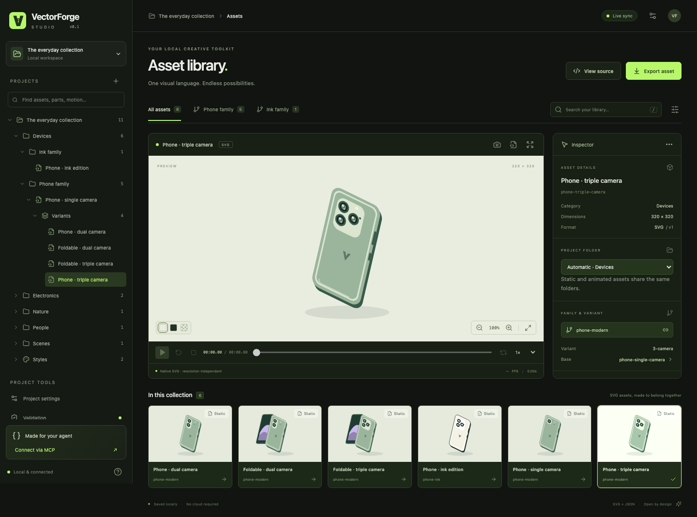
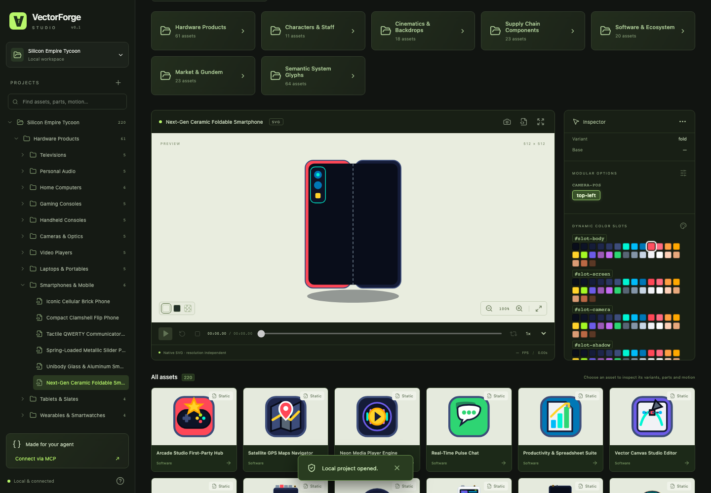
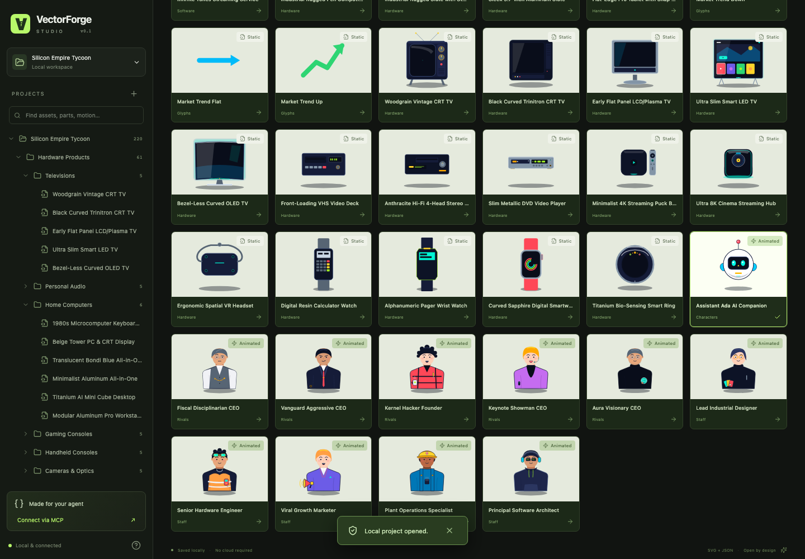
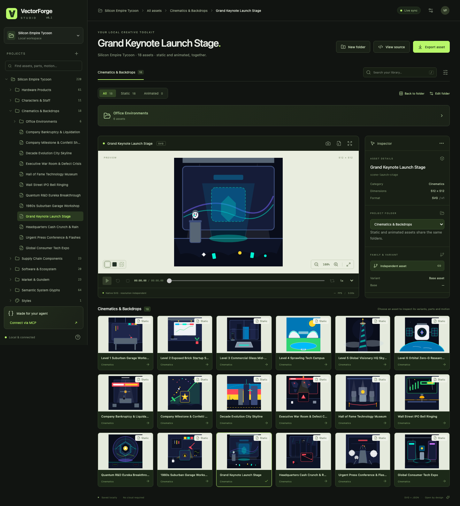
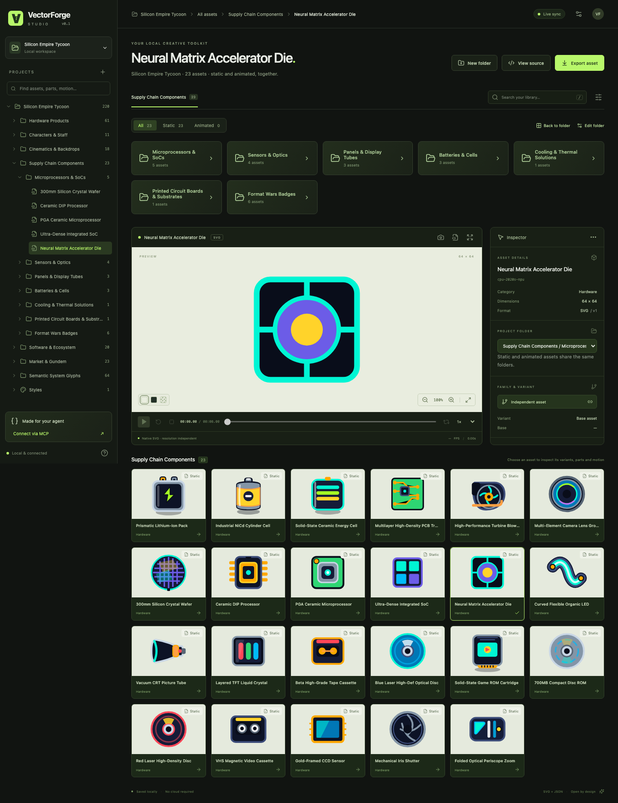
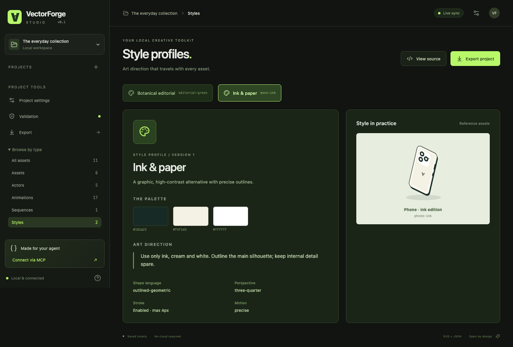
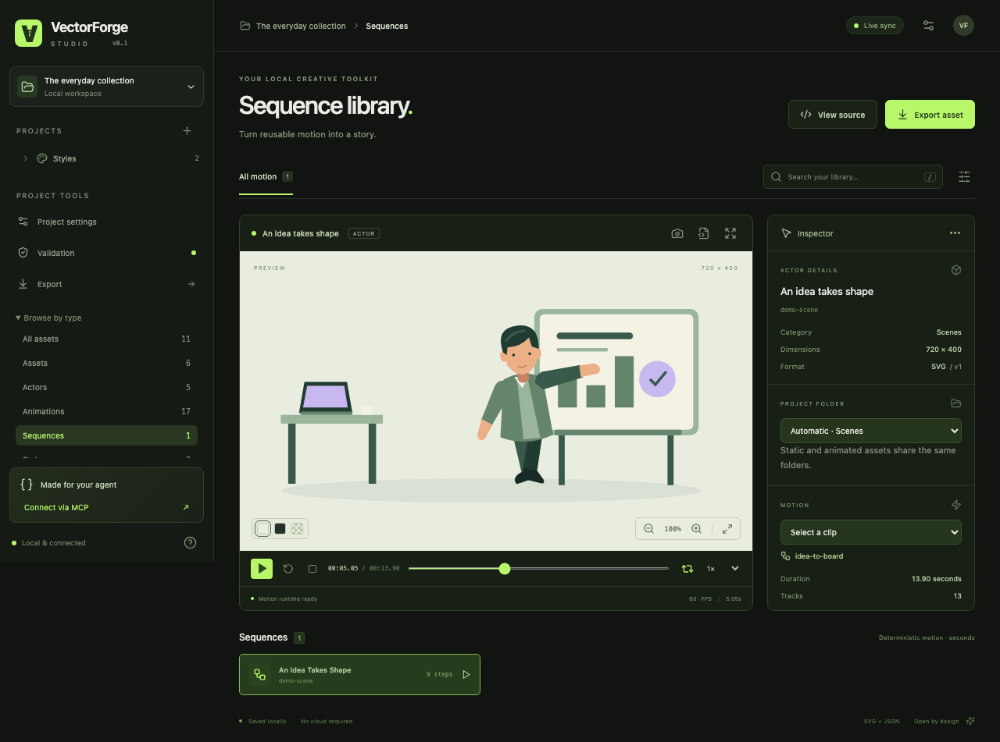

# VectorForge

[](LICENSE)
[](https://nodejs.org/)
[](docs/MCP.md)
[](https://github.com/Kaandonmez/vector-forge/stargazers)

**VectorForge — An AI-first 2D asset and motion pipeline for games, apps, and the web.**

Create coherent SVG asset families, articulate reusable actors, animate them, inspect the results and export portable files. Your existing coding agent generates the artwork. VectorForge supplies shared context, style rules, validation, deterministic motion, browser previews and visual feedback.

Everything runs locally. No API key, cloud account, subscription, database or proprietary animation runtime is required. The core does not assume a specific subject or art style.



## Showcase — Production Assets Built with VectorForge

VectorForge scales from a small component set to full game and application libraries with hundreds of cohesive static SVGs, customizable hardware variants, articulated character rigs, and cinematic backdrops.

### Modular Hardware Variants & Dynamic Color Slots

Inspect and customize modular SVG variants (`camera-pos`) and live color slots (`#slot-body`, `#slot-screen`, `#slot-camera`, `#slot-shadow`) across product families directly inside the Studio Inspector:



### Articulated Characters, Rivals & Studio Staff

Manage rigged, multi-clip animated characters with state machines and deterministic playback alongside static assets in one unified project tree:



### Cinematic Scenes, Cutscenes & Office Environments

Preview multi-layered environment backdrops and event cutscenes with instant visual feedback:



### Hardware Components, Optics & Format Badges

Organize deep nested folder collections for processors, sensors, display panels, batteries, cooling modules, and format badges:



> **Note:** The production screenshots above illustrate a 220-asset game library created with VectorForge. Only the clean `examples/generic-demo` starter project is bundled in this repository; any projects or assets you create locally stay ignored by Git so your repository remains clean.

## Quick start

Requires Node.js 22+ and pnpm 11.19+.

```sh
pnpm install
pnpm build
pnpm exec playwright install chromium
pnpm dev
```

Open **http://127.0.0.1:5173**. The bundled `examples/generic-demo` project opens automatically. Chromium is needed for snapshots and browser tests; asset management, validation and export work without it.

### Distributable CLI & Local Tarball Install

`pnpm build` compiles the Studio UI (`apps/studio/dist/`) and standalone Node.js ESM entrypoints (`dist/cli.js`, `dist/mcp.js`, `dist/index.js`, `dist/vectorforge-runtime.js`) so the CLI and MCP server run without requiring `tsx` at runtime:

```sh
# Run the compiled CLI directly:
node ./dist/cli.js --help
node ./dist/cli.js doctor

# Or create and install a portable npm tarball locally:
npm pack
npm install -g ./vectorforge-0.1.0.tgz
vectorforge --help
vectorforge doctor
```

_(Once the `vectorforge` package is published to the npm registry, `npx vectorforge --help` and `npx vectorforge mcp --project <path>` will work directly without a repository clone.)_

```sh
pnpm vectorforge --help
pnpm vectorforge doctor
pnpm vectorforge validate
pnpm vectorforge list assets
pnpm vectorforge snapshot phone-triple-camera
pnpm vectorforge snapshot studio-plant --clip gentle-sway --time 1.2
pnpm vectorforge snapshot idea-to-board --time 5
pnpm vectorforge export studio-plant --dest ./artifacts/plant --format web --dry-run
pnpm vectorforge export studio-plant --dest ./artifacts/plant --format web
```

Exports refuse conflicts unless `--overwrite` is explicitly supplied. Snapshots also require `--overwrite` to replace an existing PNG.

## Studio

- **Project tree**: each game, website or app has its own local project. Open or create projects from the project picker; recently opened projects stay in the sidebar.
- **Folders**: static assets and animated actors share one collection. Create, rename and nest project folders, then assign assets with the Inspector's **Asset folder** field. Existing projects automatically group assets by category without migration.
- **Asset branches**: variants, the actual rig hierarchy, animations, sequences and state machines appear under their owning asset. Search the tree to find a part or motion directly. Arrow keys navigate and expand the tree.
- **Folder view**: click a folder for thumbnail cards, filter static/animated assets and search; click an asset for preview, playback and the Inspector. Breadcrumbs return to parent folders. On mobile, the tree opens in a drawer.
- **Project settings**: context, rules, counts and the project directory.
- **Assets**: thumbnails, search, families, variant relationships and style inspection.
- **Actors**: SVG preview, rig nodes, hierarchy, pivots, clips and state events.
- **Animations**: selectable clips and inspectable keyframe tracks.
- **Sequences**: deterministic multi-step playback, scrubbing and looping.
- **Styles**: palettes, geometry, perspective, written guidance and reference assets.
- **Validation**: actionable errors and warnings with source file locations.
- **Source**: inspect and edit SVG, metadata, rig, clip, sequence and style JSON. Changes are validated before writing.
- **Export**: inspect a dry-run plan, choose a destination and explicitly handle conflicts.

Preview backgrounds, zoom, fit, playback speed, play/pause/stop/restart, loop and seek all operate on real project data. The camera button writes a unique PNG to the project's `exports/snapshots/` folder. External file changes refresh the Studio through Vite's watcher. Invalid SVG is kept out of previews.

The **Browse by type** menu retains Assets, Actors, Animations, Sequences and Styles views. Folder definitions are portable `collections` in `vectorforge.context.json`; asset/actor metadata stores an optional `collection` ID. Organizing assets never changes source paths or motion IDs. Recent projects and tree expansion preferences are stored only in this browser. See [project organization](docs/PROJECTS.md).

| Style Profiles & Art Direction                           | Deterministic Sequences & Playback                             |
| -------------------------------------------------------- | -------------------------------------------------------------- |
|  |  |

## CLI

```sh
pnpm vectorforge init ./projects/my-project --name "My visual project"
pnpm vectorforge doctor --project ./projects/my-project
pnpm dev --project ./projects/my-project
pnpm vectorforge context --project ./projects/my-project
pnpm vectorforge create style ./style.json --project ./projects/my-project
pnpm vectorforge create asset ./asset.json --svg ./asset.svg --project ./projects/my-project
pnpm vectorforge variant base-id ./variant.json --svg ./variant.svg --project ./projects/my-project
pnpm vectorforge create actor ./actor.json --svg ./actor.svg --rig ./rig.json --project ./projects/my-project
pnpm vectorforge create animation ./animation.json --project ./projects/my-project
pnpm vectorforge create sequence ./sequence.json --project ./projects/my-project
pnpm vectorforge update asset ./asset.json --svg ./asset.svg --project ./projects/my-project
pnpm vectorforge export-all --dest ./output --format flutter --dry-run --project ./projects/my-project
pnpm vectorforge export-all --dest ./output --format flutter --project ./projects/my-project
```

`create` rejects existing IDs; `update` requires an existing resource. Create styles before dependent assets, actors before clips, and clips before sequences. Add an actor's `clips` and `stateMachine` references after those resources exist. Local user projects and generated outputs under `projects/`, `output/`, `exports/`, `artifacts/` and custom `examples/*` directories are ignored by Git so your own asset production stays out of version control.

## MCP & Agent Skills

The first-class stdio server uses the [official Model Context Protocol TypeScript SDK](https://ts.sdk.modelcontextprotocol.io/server). Start it with:

```sh
# Using the compiled distribution (after pnpm build):
node ./dist/cli.js mcp --project ./examples/generic-demo

# Or via pnpm during development:
pnpm vectorforge mcp --project ./examples/generic-demo
```

### Client Setup (Claude Code, Cursor, VS Code / GitHub Copilot & Generic MCP Clients)

Each MCP process locks to one project directory (`--project <path>` or `VECTORFORGE_PROJECT`). Pass `--init` (or call `vectorforge_init_project` over MCP) to initialize an empty project directory on first run.

- **Repository Checkout Mode (Works Immediately Today Before npm Publication)**:
  ```json
  {
    "mcpServers": {
      "vectorforge": {
        "command": "node",
        "args": ["/path/to/vector_forge/dist/cli.js", "mcp", "--project", "/path/to/my-project"]
      }
    }
  }
  ```
- **Claude Code (`.mcp.json`) / Cursor (`.cursor/mcp.json`) _(after npm publication or local `npm install -g ./vectorforge-0.1.0.tgz`)_**:
  ```json
  {
    "mcpServers": {
      "vectorforge": {
        "command": "npx",
        "args": ["-y", "vectorforge", "mcp", "--project", "."]
      }
    }
  }
  ```
- **VS Code / GitHub Copilot (`.vscode/mcp.json`) _(after npm publication or local tarball install)_**:
  ```json
  {
    "servers": {
      "vectorforge": {
        "type": "stdio",
        "command": "npx",
        "args": ["-y", "vectorforge", "mcp", "--project", "${workspaceFolder}"]
      }
    }
  }
  ```

### Bundled Agent Skill (`SKILL.md` Standard)

This repository includes the free **[VectorForge MCP Starter Skill](skills/vectorforge-mcp-starter/SKILL.md)** (`skills/vectorforge-mcp-starter/`), which guides MCP-connected coding agents through the complete workflow:

Read context → inspect style and siblings → generate SVG/JSON → create/update → validate → snapshot → inspect → export.

See [MCP setup and tool reference](docs/MCP.md) and [Starter skill documentation](skills/vectorforge-mcp-starter/README.md).

## Project format

```text
my-project/
├── vectorforge.project.json
├── vectorforge.context.json
├── styles/<style-id>/style.json
├── assets/<asset-id>/{asset.svg,asset.json}
├── actors/<actor-id>/{actor.svg,actor.json,rig.json}
├── animations/<clip-id>.json
├── sequences/<sequence-id>.json
├── state-machines/<machine-id>.json
└── exports/
```

All VectorForge JSON resources use `schemaVersion: 1`. SVG stays native XML. IDs match directory/file names. Future versions will need explicit migrations; v0.1 rejects unsupported schema versions instead of guessing. See [formats and coordinate conventions](docs/FORMATS.md).

Styles are extensible JSON profiles containing a palette, optional geometry/stroke/lighting/perspective/motion rules, written guidance and references. Art direction is advisory; objective SVG structure, palette and stroke rules can be checked automatically. Assets have metadata, family/base/variant relationships and a self-contained SVG. Actors add a rig mapping generic logical nodes to stable SVG IDs.

## Animation and sequences

Tracks target `node.position.x`, `node.position.y`, `node.rotation`, `node.scale.x`, `node.scale.y`, `node.opacity`, `node.fill` or `node.stroke`. **All durations and keyframe times are seconds. Rotation is degrees. Position is SVG user units.** Color keyframes use `#RRGGBB`.

The renderer uses SVG DOM transforms and `requestAnimationFrame`; React does not rerender each motion frame. Playback supports speed, seek, loop and reverse via the motion API. Eleven easing functions cover linear, quadratic, cubic and back overshoot. Keyframe easing belongs to the destination frame.

Sequences support `play`, `wait`, `moveTo`, `rotateTo`, `parallel` and bounded `repeat`. They compile to a deterministic timeline for repeatable snapshots and scrubbing. Completed actions hold their final pose; later actions override properties they target. Parallel steps should animate different properties. State machines support event, explicit boolean condition and animation-completion transitions. Conditions are supplied data, never evaluated JavaScript.

## Validation

Schemas, supported versions, dimensions, XML parsing, unsafe content, duplicate IDs, internal SVG references, metadata, base/family/style relationships, rig mappings/cycles, clip nodes, keyframe ordering, duration, easing, sequences and state references are checked. Style checks report prohibited colors as errors and palette/stroke discrepancies as warnings. Warnings do not block export. Validation does not claim to measure subjective illustration quality.

Writes reject traversal and project symlinks. Active SVG content, scripts, foreign markup, event attributes, external images/styles and DTD/entities are unsupported. Studio binds to loopback and rejects cross-origin writes. This is a local developer tool; it is not designed as a public server.

## Exporting

Exporter adapters share one safety/manifest layer:

| Format  | Output                                                                                                                             |
| ------- | ---------------------------------------------------------------------------------------------------------------------------------- |
| Generic | SVG, metadata, styles, rigs, clips, sequences, machines and manifest; reopenable as a VectorForge project                          |
| Web     | Generic files plus a dependency-free ES module runtime and a working HTML demo                                                     |
| Flutter | `assets/vectorforge/{static,actors,animations,sequences,styles,...}`, manifest and a complete nested `pubspec-assets.yaml` snippet |

Actor exports include their referenced motions and styles; variants include the base chain. Destinations are checked before writes. Dry run lists every file and conflict without creating a directory. Project source directories and symbolic-link destinations are protected. Serve web exports through any static HTTP server; `file://` fetch restrictions apply.

Flutter export packages portable assets and motion data. It **does not include a Dart/Flame motion runtime**; integrate the JSON with your application's renderer. Static SVG use can rely on a renderer of your choice. Flutter itself need not be installed for export.

## Troubleshooting

- **Check Installation & Project Health:** Run `pnpm vectorforge doctor --project <path>` (or `vectorforge doctor`) to verify Node.js >= 22, MCP server readiness, Studio UI build, Playwright Chromium availability, and project validation status.
- **Missing Chromium on Snapshot:** If `snapshot` reports `Playwright Chromium is missing`, run `npx playwright install chromium` (or `pnpm exec playwright install chromium`).
- **Missing Project (`No VectorForge project at ...`):** Run `vectorforge init <directory>` first, or pass `--init` when starting `vectorforge mcp`.
- **Export Conflict Errors:** Always preview exports with `--dry-run` (`dryRun: true` in MCP). Pass `--overwrite` (`overwrite: true`) only when you intend to replace existing destination files.

## Architecture

```text
apps/studio/                      React + Vite inspection UI
packages/schema/                  Runtime schemas and shared types
packages/svg/                     Static SVG and objective style validation
packages/core/                    Files, project context, safe CRUD, snapshots
packages/motion/                  Easing, interpolation, playback, sequences, states
packages/renderer-web/            Generic SVG DOM articulation
packages/cli/                     Local command-line interface
packages/mcp/                     Official SDK stdio interface
packages/exporters/               Generic, web and Flutter adapters
skills/vectorforge-mcp-starter/   Free Agent Skill (SKILL.md) for MCP onboarding
examples/generic-demo/            Ordinary portable demo project
tests/                            Unit, filesystem, CLI, MCP, distribution and browser tests
```

Static SVG validation does not depend on the motion engine. The motion engine knows nodes and properties, not plants, people or electronics. Styles and demo artwork are files, not engine defaults. See [architecture and decisions](docs/ARCHITECTURE.md).

## Demo

The everyday collection contains **6 static assets, 5 actors, 17 animation clips, 2 styles, 1 sequence and 1 state machine**. The phone family has single/dual/triple-camera and two foldable variants. An equivalent ink edition shows a different style. Non-human motion includes asynchronous chip indicators, processor energy effects and a plant with overlapping leaf motion. The maker has idle, walk, typing, talk, nod, point, write and celebrate clips. The desk/board scene combines movement, turning, pointing, drawing, talking and returning to idle.

`pnpm demo:generate` reproducibly regenerates this bundled demo. It replaces demo files; use a separate project for your own artwork.

## Development and testing

```sh
pnpm typecheck
pnpm lint
pnpm test
pnpm test:browser
pnpm build
```

`pnpm test` exercises real schemas, motion, SVG validation, safe file operations, exporter conflicts, CLI processes, an official MCP client, PNG generation and clean npm tarball distribution. `pnpm test:browser` verifies Studio flows, every demo asset/human clip, object motion, sequence playback, source validation, snapshots, file reload and mobile layout. It writes visual QA images to `artifacts/qa/` and a Playwright report. See [verification notes](docs/VERIFICATION.md).

`pnpm build` typechecks, builds the browser UI (`apps/studio/dist/`) and compiles the Node ESM CLI/MCP distribution (`dist/`). The Studio UI uses the local file API and is designed for local loopback execution rather than public cloud hosting.

## v0.1 limits and roadmap

- Source editing is lightweight; there is no drawing editor or draggable keyframe timeline.
- Fill/stroke tracks target mapped elements. Explicit colors on descendants remain authored; map those descendants to animate them individually.
- Sequence composition is ordered property overlay. There is no additive blending, constraints, IK or arbitrary script execution.
- Writes are atomic per resource file with rollback for a failed bundle. There is no cross-process locking; avoid simultaneous writers to the same resource. Exports preflight all files, but a later filesystem error can leave an incomplete destination; the returned failure never claims completion.
- Optional state-machine conditions are explicitly supplied booleans. Studio's demo events and busy condition demonstrate the API; no condition expression editor is included.
- Future directions: migration helpers, standalone Dart/Godot adapters, richer validators and optional AI providers. These are not required to use the local workflow.

## Star History

<a href="https://www.star-history.com/#Kaandonmez/vector-forge&Date">
 <picture>
   <source media="(prefers-color-scheme: dark)" srcset="https://api.star-history.com/svg?repos=Kaandonmez/vector-forge&type=Date&theme=dark" />
   <source media="(prefers-color-scheme: light)" srcset="https://api.star-history.com/svg?repos=Kaandonmez/vector-forge&type=Date" />
   
 </picture>
</a>

## License and contribution

MIT. Dependency licenses are summarized in [DEPENDENCIES.md](docs/DEPENDENCIES.md). See [CONTRIBUTING.md](CONTRIBUTING.md). No external repository or deployment is required.
